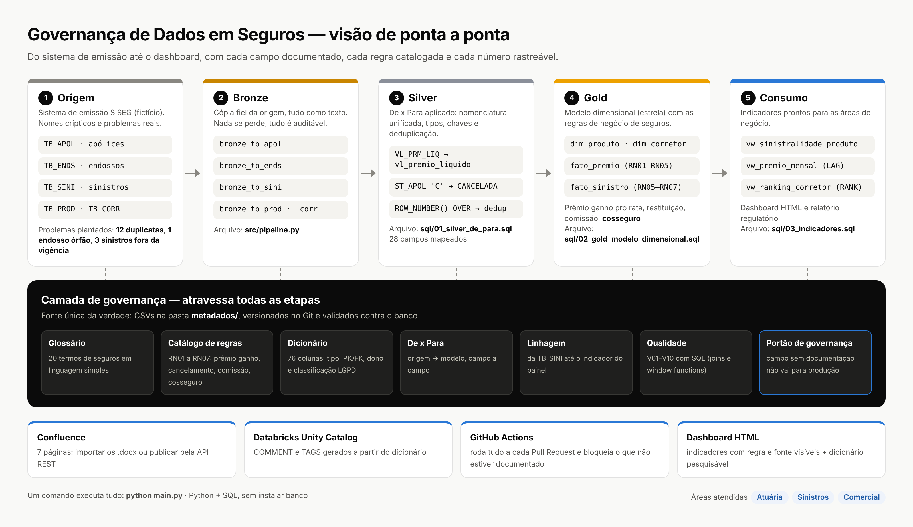
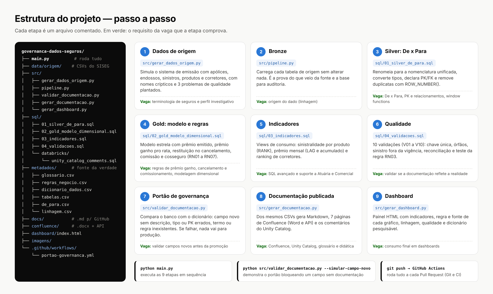
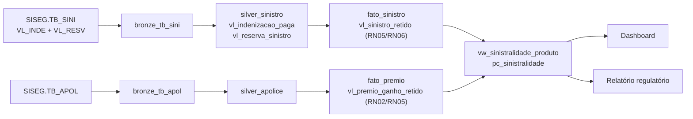
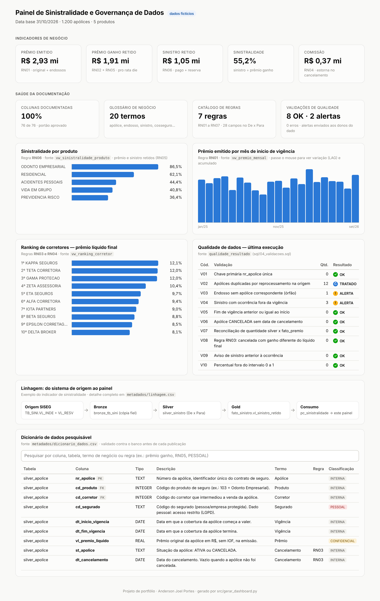

# Governança de Dados em Seguros — Dicionário, Regras, Linhagem e Qualidade

Projeto de portfólio que mostra, de ponta a ponta, como transformar dados de um sistema
legado de seguros em uma **"biblioteca de dados" viva**: cada campo documentado, cada regra
de negócio catalogada, cada número rastreável até a origem — e nenhum campo novo indo para
produção sem documentação.

> Dados 100% fictícios, gerados por script. Roda em qualquer máquina com Python 3.10+, sem instalar banco de dados.



## O problema de negócio
As áreas de Atuária, Sinistros e Comercial calculavam a **sinistralidade** cada uma do seu jeito
(prêmio emitido x prêmio ganho, com ou sem cosseguro) e os números não batiam.
O projeto resolve isso com três frentes:

1. **Nomenclatura unificada** — um De x Para do legado (`VL_PRM_LIQ`) para nomes de negócio (`vl_premio_liquido`).
2. **Regras oficiais catalogadas** — prêmio ganho, cancelamento, comissão, cosseguro e sinistralidade (RN01 a RN07).
3. **Documentação que não fica desatualizada** — um portão automático compara a documentação com o banco a cada mudança.

## Como executar
```bash
pip install -r requirements.txt     # opcional: só para gerar os .docx do Confluence
python main.py                      # roda as 9 etapas
# abra dashboard/index.html no navegador
```
Demonstração do portão de governança (a Engenharia cria um campo e esquece de documentar):
```bash
python src/validar_documentacao.py --simular-campo-novo
# REPROVADO — [D1] fato_premio.vl_iof: Campo existe no banco mas NÃO está documentado
```

## Passo a passo


| # | Etapa | Arquivo | O que faz |
|---|---|---|---|
| 1 | Origem | `src/gerar_dados_origem.py` | Simula o sistema de emissão SISEG com 3 problemas de qualidade plantados |
| 2 | Bronze | `src/pipeline.py` | Cópia fiel da origem (auditoria) |
| 3 | Silver | `sql/01_silver_de_para.sql` | De x Para, tipos, PK/FK, deduplicação com `ROW_NUMBER()` |
| 4 | Gold | `sql/02_gold_modelo_dimensional.sql` | Modelo estrela + regras RN01–RN07 |
| 5 | Indicadores | `sql/03_indicadores.sql` | Sinistralidade (`RANK`), prêmio mensal (`LAG`, `SUM OVER`), ranking de corretores |
| 6 | Qualidade | `sql/04_validacoes.sql` | 10 validações: chave única, órfãos, vigência, reconciliação, teste de regra |
| 7 | Portão | `src/validar_documentacao.py` | Documentação x realidade do banco (D0–D8); falhou, não promove |
| 8 | Publicação | `src/gerar_documentacao.py` | Markdown, Confluence (Word + API) e Unity Catalog a partir dos mesmos CSVs |
| 9 | Dashboard | `src/gerar_dashboard.py` | Painel HTML com regra e fonte de cada número |

## Linhagem do indicador principal


## A biblioteca de dados (pasta `metadados/`)
| Arquivo | Conteúdo | Quem usa |
|---|---|---|
| `glossario.csv` | 20 termos de seguros em linguagem simples (apólice, endosso, sinistro, prêmio ganho, cosseguro…) | Negócio |
| `regras_negocio.csv` | Catálogo RN01–RN07 com fórmula, área dona, versão e status | Atuária, Governança |
| `dicionario_dados.csv` | 76 colunas: tipo, PK/FK, descrição, termo, regra, classificação LGPD, dono | Todos |
| `tabelas.csv` | Descrição, grão e dono de cada tabela | Todos |
| `de_para.csv` | Mapeamento campo a campo origem → modelo | Engenharia |
| `linhagem.csv` | Caminho tabela a tabela até o dashboard e o relatório regulatório | Governança, Auditoria |

Os CSVs são a **fonte única da verdade**: abrem no Excel, ficam versionados no Git e geram todo o resto.

## Resultado da execução
| Indicador | Valor |
|---|---|
| Apólices | 1.200 |
| Prêmio emitido | R$ 2,93 mi |
| Prêmio ganho retido | R$ 1,91 mi |
| Sinistralidade da carteira | 55,2% (Odonto 86,5% lidera o ranking) |
| Colunas documentadas | 76 de 76 (100%) |
| Validações | 8 OK/tratadas · 2 alertas enviados aos donos do dado · 0 erros |



## Confluence
- **Importação manual:** `confluence/word/*.docx` → no Confluence Cloud, *Criar* → *Mais ações (…)* → *Modelos e importação* → *Importar* → *Documento do Word*. Cada arquivo vira uma página (até 30 por vez).
- **Automática:** `python confluence/publicar_confluence.py` publica as páginas em formato nativo (com sumário e etiquetas de status coloridas) usando a API REST. Teste antes com `--simular`.

## Do SQLite para a nuvem
O projeto usa SQLite para rodar em qualquer lugar; os conceitos são os mesmos da plataforma real:

| Aqui | Databricks | AWS |
|---|---|---|
| Camadas bronze/silver/gold | Medallion em Delta Lake | S3 com prefixos por camada |
| `dicionario_dados.csv` | Unity Catalog (`COMMENT`, `TAGS`) — ver `sql/databricks/` | Glue Data Catalog |
| Classificação `PESSOAL` | Tags + máscaras de coluna | Lake Formation (permissões por coluna/tag) |
| Consultas SQL | Databricks SQL | Athena |
| `linhagem.csv` | Lineage automático do Unity Catalog | — |

## Decisões e premissas
- **Fonte única da verdade em CSV**: qualquer analista edita no Excel; o Git guarda o histórico de quem mudou o quê.
- **FKs informativas**: como no Unity Catalog, não são impostas pelo banco; a integridade é garantida pela validação V03.
- **Premissas declaradas** na especificação funcional (`docs/especificacao_funcional_sinistralidade.md`): data base 31/10/2026, endossos distribuídos por toda a vigência, valores sem IOF, resseguro fora do escopo.
- **Padrões DAMA-DMBOK** aplicados: metadados, qualidade, glossário de negócio, linhagem, dono do dado e classificação.

## Autor
**Anderson Joel Portes** — Analista de Dados e BI · [LinkedIn](https://linkedin.com/in/anderson-joel-portes) · [GitHub](https://github.com/AndersonJP)
