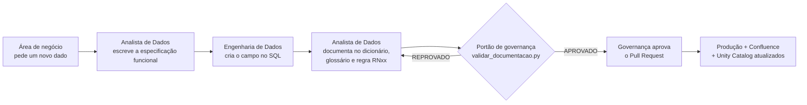

# Processo — como um campo novo chega à produção

Mapeamento do processo de governança: da necessidade de negócio até o campo documentado em produção.

| Etapa | Responsável | Entregável | Onde fica |
|---|---|---|---|
| 1. Necessidade | Área de negócio | Pedido com a pergunta de negócio | Jira / e-mail |
| 2. Especificação | Analista de Dados | Especificação funcional | `docs/especificacao_funcional_*.md` |
| 3. Desenvolvimento | Engenharia de Dados | SQL do campo | `sql/` |
| 4. Documentação | Analista de Dados | Dicionário, glossário, regra, De x Para | `metadados/*.csv` |
| 5. Validação | Automática (CI) | Relatório do portão | GitHub Actions |
| 6. Aprovação | Governança | Pull Request aprovado | GitHub |
| 7. Publicação | Automática | Confluence e Unity Catalog | `src/gerar_documentacao.py` |

**Regra de ouro:** se a etapa 5 reprovar, o campo não vai para produção.
Demonstração: `python src/validar_documentacao.py --simular-campo-novo`
